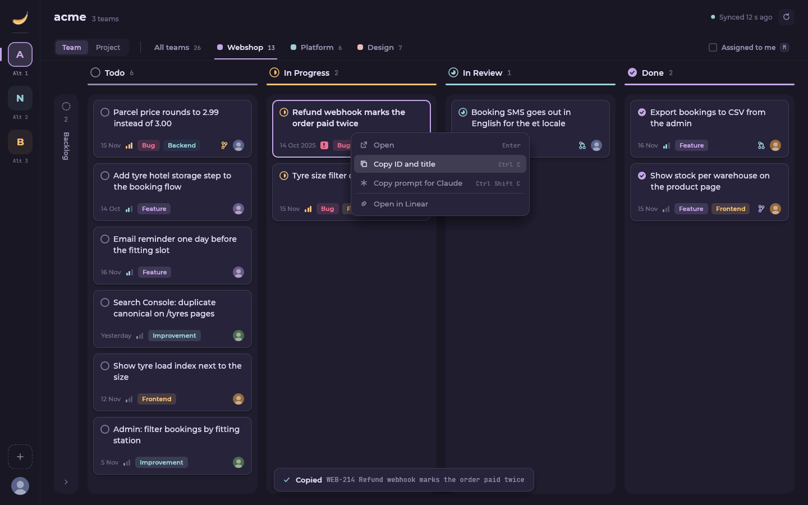
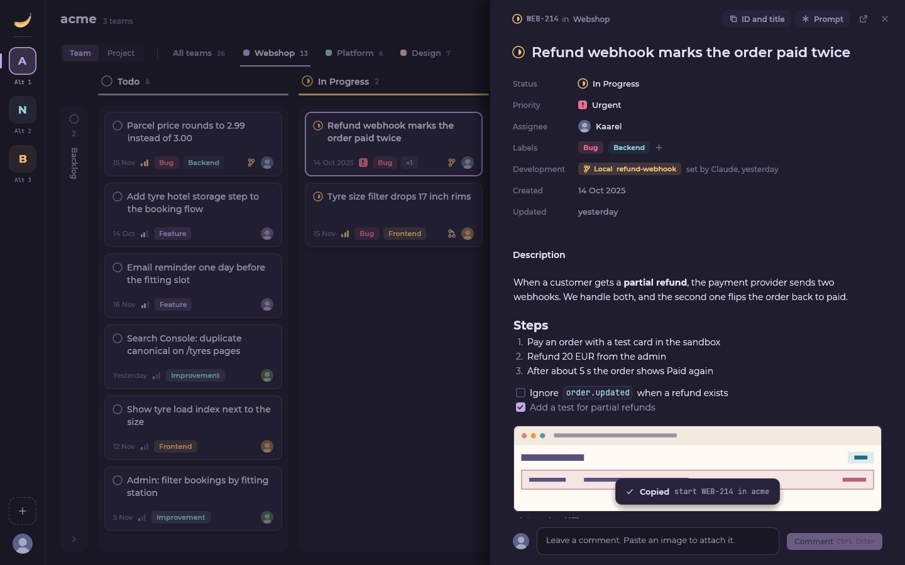
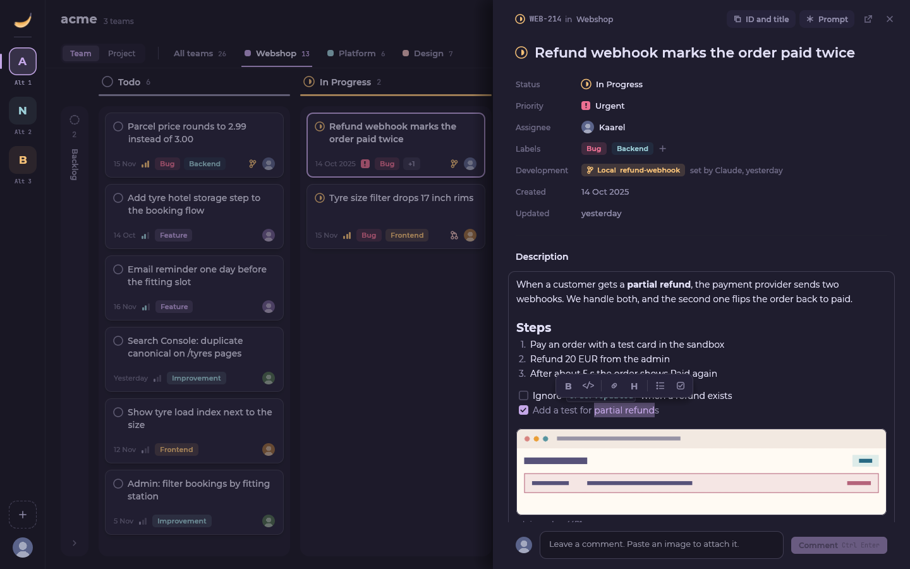
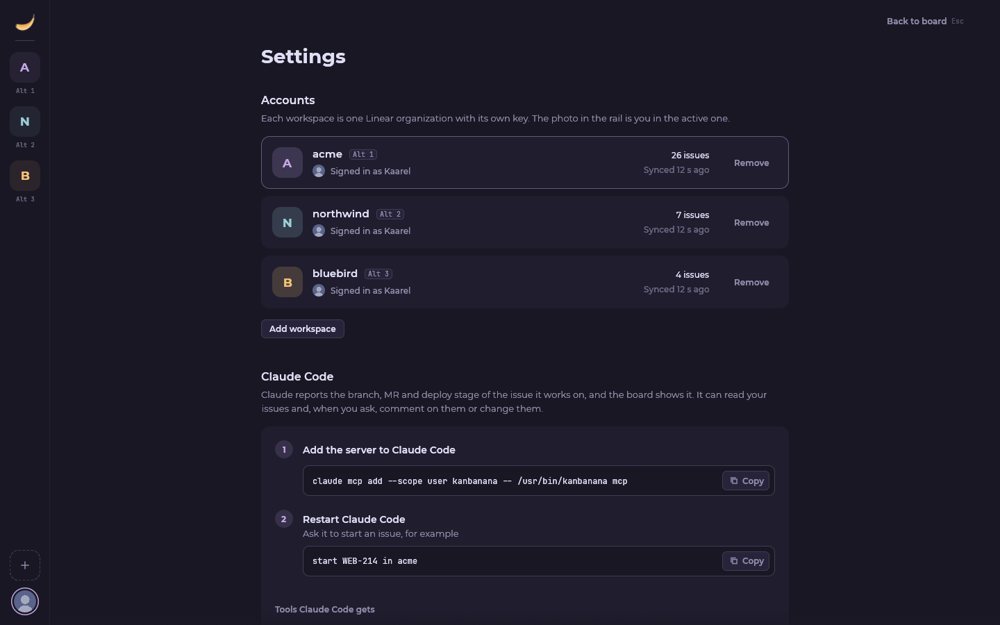
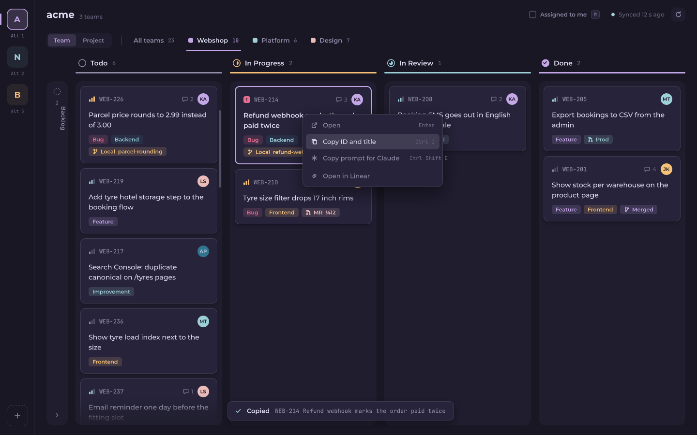
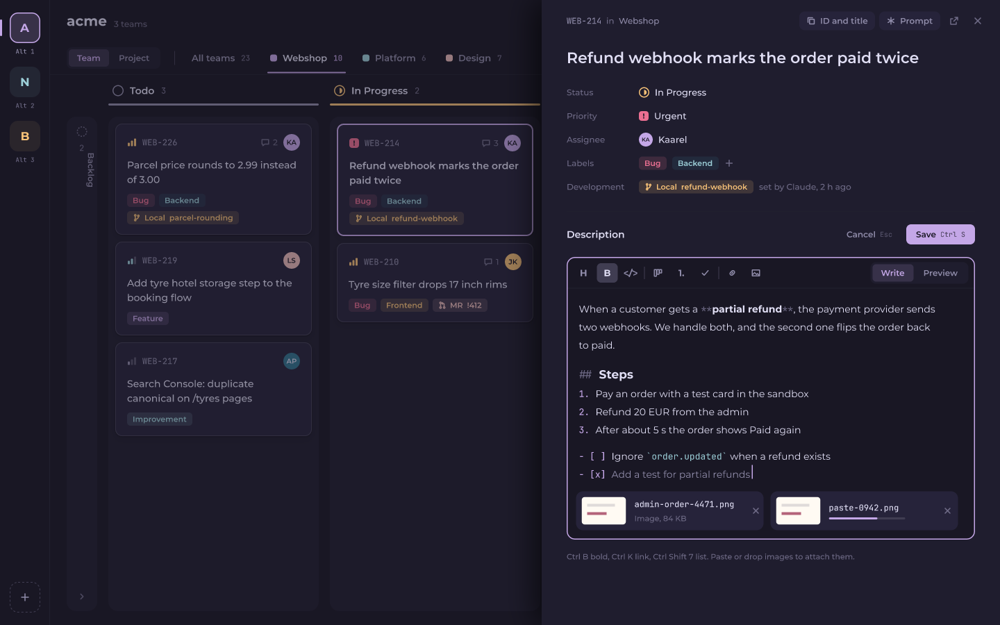
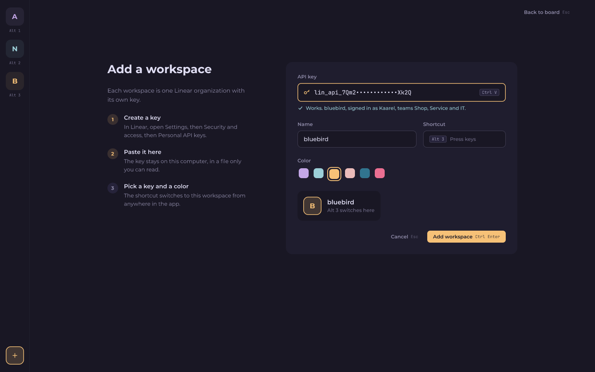

<p align="center">
  
</p>

<h1 align="center">Kanbanana</h1>

<p align="center">A kanban board for your <a href="https://linear.app">Linear</a> issues. Slightly bananas.</p>

A fast desktop kanban board for Linear, with Claude Code built in. Kanban is the board where
cards move from column to column as the work moves on. Native Rust (egui), Rosé Pine colors,
opens instantly from a local cache.

Unofficial. Not made by or affiliated with Linear.



## Why

- **Several Linear workspaces in one window.** Each one has its own color and a shortcut
  (Alt+1 to Alt+9, Option on macOS), so you always see which client you are in.
- **A board that reads at a glance.** Workflow states as columns, cards sorted by urgency,
  teams or projects as tabs, each column scrolls on its own.
- **Edit like in Linear.** Title and description are editable in place, with headings,
  lists, checklists, code, links and images. You never see raw markdown. Changes save by
  themselves.
- **Claude Code knows your board.** Over MCP, Claude reports which issue it works on and how
  far the code got (Local, MR, Merged, Staging, Prod), and the card shows it.



## Features

- Board grouped by team or by project, with an "Assigned to me" filter.
- Drag cards between columns to change their status.
- Issue panel: status, priority, assignee and labels pickers, description editor,
  comments with replies, created and updated dates.
- Paste or drop an image to upload it to Linear. Images in descriptions and comments show
  inline.
- Right-click a card, or press Ctrl+C / Ctrl+Shift+C (Cmd on macOS), to copy
  `WEB-214 Issue title` or a ready prompt for Claude: `start WEB-214 in acme`.
- Syncs on window focus and every 30 seconds, and respects Linear's rate limits.
- Nine themes: Rosé Pine (main, moon, dawn), Catppuccin Mocha and Latte, Tokyo Night, Gruvbox Dark, Nord and Dracula.



## Install

Packages are planned for the AUR and Homebrew under the name `kanbanana`
(`yay -S kanbanana`, `brew install kanbanana`). They are not published yet.
Until then, build from source:

1. Install Rust (stable, edition 2024): <https://rustup.rs>
2. Platform tools:
   - **macOS:** the Xcode command line tools: `xcode-select --install`
   - **Debian or Ubuntu:** `sudo apt install build-essential libxkbcommon-dev libwayland-dev`
   - **Arch:** `sudo pacman -S base-devel`
3. Build and run:

   ```
   git clone https://github.com/kaareloun/kanbanana
   cd kanbanana
   cargo build --release
   ./target/release/kanbanana
   ```

On Linux the file picker for "Attach image" uses the XDG desktop portal, which most
desktops already run. To get it in your app launcher, copy `assets/kanbanana.desktop` to
`~/.local/share/applications/` and `assets/brand/icon.png` to
`~/.local/share/icons/hicolor/512x512/apps/kanbanana.png`.

## Add a workspace

On first start Kanbanana walks you through three steps: pick a theme, link your first
workspace, and connect Claude Code. You can run it again from Settings, About.

To add more workspaces later:

1. In Linear, open Settings, then Security and access, then Personal API keys, and create a key.
2. In the app, click the **+** tile at the bottom of the left rail and paste the key.
3. Pick a name, a shortcut and a color.

Repeat for every Linear workspace you use.

## Claude Code

Connect it once. The command with the exact path is also in the app under
**Settings, Claude Code** (open Settings with your profile picture at the bottom of the
rail, or Ctrl+, / Cmd+,):

```
claude mcp add --scope user kanbanana -- /path/to/kanbanana mcp
```



Restart Claude Code. Nothing else to set up. The server tells Claude what to do: when it
starts work in a repository it asks which issue the work belongs to, and it reports the
branch, merge request and deploy stage as the work moves on. The app itself never reads
your repositories.

To start work on an issue, copy its prompt from the board (Ctrl+Shift+C) and paste it into
Claude Code.

Claude can also read issues and comments, and change issues or comment when you ask it
to. Claude Code asks you before it runs a tool, as for any MCP server.

| Tool | What it does |
|---|---|
| `current_issue` | Finds the issue for the current branch or worktree path. |
| `set_dev` | Sets the dev stage, branch, path and MR URL of an issue. Local only. |
| `list_issues` | Lists cached issues by workspace, team, state, assignee or text. |
| `get_issue` | Reads an issue with its description, dev state and comments. |
| `update_issue` | Changes state, assignee, priority, labels, title or description in Linear. |
| `add_comment` | Comments on an issue in Linear. |
| `list_workspaces` | Lists the workspaces added in the app. |

## Keyboard

| Keys | Action |
|---|---|
| Alt+1 to Alt+9 | Switch workspace (Option on macOS) |
| M | Toggle "Assigned to me" |
| R | Sync now |
| Ctrl+C | Copy the issue id and title |
| Ctrl+Shift+C | Copy a prompt for Claude |
| Ctrl+, | Settings |
| S, P, A, L | Status, priority, assignee, labels picker (issue open) |
| E | Edit the description |
| Esc | Close the picker, leave the editor, close the panel |
| Ctrl+B, Ctrl+E, Ctrl+K | Bold, code, link |
| Ctrl+Shift+7 / 8 / 9 | Numbered list, bullet list, checklist |
| Ctrl+Enter | Send a comment |

On macOS use Cmd instead of Ctrl.

## Your data

- **API keys** are in `credentials.json`, a file only your user can read (mode 0600), the
  same way the GitHub CLI and Claude Code keep their tokens. No keyring daemon, no password
  prompts. Location: `~/.config/kanbanana/` on Linux,
  `~/Library/Application Support/kanbanana/` on macOS
  (override with `KANBANANA_CREDENTIALS`).
- **Cache** of your issues is `cache.sqlite3` in `~/.local/share/kanbanana/` on Linux and
  `~/Library/Application Support/kanbanana/` on macOS (override with `KANBANANA_DB`).
  Delete it any time; the next sync fills it again.
- **Dev stages** that Claude reports stay on your machine. They are not sent to Linear.
- The app talks to Linear's API and file hosts, and loads the images that issues and
  profiles link to. Your API key is only sent to Linear.

## Platforms

Linux (Wayland and X11) and macOS. CI builds and tests both on every push
(`.github/workflows/ci.yml`).

## Design

The interface was designed first, in figcraft, and then built to
match. The design files and the generator scripts are in `design/`. The banana and the
app icon are SVGs in `assets/brand/`.







## Development

The workspace has one crate per layer:

| Crate | Job |
|---|---|
| `crates/model` | Shared types |
| `crates/linear_api` | Linear GraphQL client |
| `crates/store` | SQLite cache, workspaces, dev state, credentials file |
| `crates/sync` | Background engine: sync loop, edits, comments, uploads, images |
| `crates/mcp` | MCP server for Claude Code (`kanbanana mcp`) |
| `crates/app` | The egui app and the binary |

```
cargo test --workspace
cargo run -p kanbanana -- --mock          # mock data, no Linear key needed
cargo run -p kanbanana -- --mock --screen panel
```

Contributor notes are in [AGENTS.md](AGENTS.md). The approved designs are in `design/`.

## License

MIT. See [LICENSE](LICENSE).
